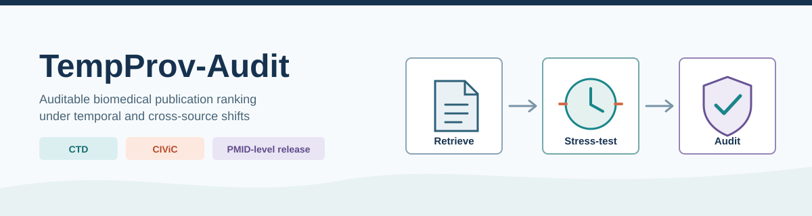

<p align="center">
  
</p>

<p align="center">
  <a href="https://github.com/Hero-Legend/TempProv-Audit/releases/latest"></a>
  <a href="pyproject.toml"></a>
  <a href="LICENSE"></a>
  <a href="data/release_manifest.json"></a>
  <a href="tests"></a>
</p>

<p align="center">
  <strong>A reproducible audit suite for biomedical publication ranking under candidate-scale, temporal, and cross-source shifts.</strong>
</p>

<p align="center">
  <a href="#-quick-start">Quick start</a> &nbsp;|&nbsp;
  <a href="docs/REPRODUCING.md">Reproduce</a> &nbsp;|&nbsp;
  <a href="data/README.md">Browse data</a> &nbsp;|&nbsp;
  <a href="DATA_LICENSE.md">Data terms</a> &nbsp;|&nbsp;
  <a href="CITATION.cff">Cite</a>
</p>

---

TempProv-Audit releases frozen PMID-level benchmark annotations and executable
retrieve-and-rerank pipelines for studying how biomedical ranking systems behave
outside conventional sampled, static evaluation settings.

> [!IMPORTANT]
> This repository contains **code and frozen benchmark data only**. It does not
> distribute the manuscript, paper figures, aggregate experimental results,
> model predictions, API responses, trained checkpoints, PubMed article text,
> or the CTD source report.

## 🔬 At a glance

| 🧬 CTD universe | 🩺 CIViC universe | 🗂️ Frozen artifacts | ⏱️ Temporal window |
| :---: | :---: | :---: | :---: |
| **55,001 PMIDs** | **2,226 PMIDs** | **61 checksummed files** | **2021--2026** |

## 🧭 What this release supports

- **Candidate-scale auditing** across a 55,001-document CTD citation universe.
- **Temporal stress testing** with rolling-origin splits and a locked historical firewall.
- **Cross-source transfer** using a frozen CIViC endpoint with 754 query/gold-PMID records.
- **Retrieval and reranking controls** spanning sparse, dense, cross-encoder, and generative methods.
- **Release integrity checks** for checksums, split isolation, and forbidden article-text fields.

## 🧬 Released benchmark layers

| Layer | Public artifact | Text policy |
| --- | --- | --- |
| CTD sampled and disease-tail-disjoint | Query, label, split, candidate PMID, year, and provenance-source metadata | No PubMed title or abstract text |
| CTD rolling origin (2024 and 2025) | Frozen fold assignments and PMID-level candidates | No PubMed title or abstract text |
| 2021--2026 historical firewall | Strict, expanded zero-shot, and all-locked query manifests | No PubMed title or abstract text |
| CIViC independent transfer | Frozen 754 query/gold-PMID file and CC0 CIViC source snapshot | No PubMed title or abstract text |
| Candidate universes | CTD and CIViC PMID/year inventories | No article text |

The CTD release contains **unlabelled candidates**, not confirmed biological
negatives. A PMID that is not cited for a target pair must not be interpreted as
biologically irrelevant.

## ⚡ Quick start

Python 3.10 or newer is required. GPU experiments additionally require a CUDA
build of PyTorch compatible with the local driver.

```bash
git clone https://github.com/Hero-Legend/TempProv-Audit.git
cd TempProv-Audit
python -m venv .venv
source .venv/bin/activate
pip install --upgrade pip
pip install -e .
```

On Windows PowerShell, activate the environment with
`.venv\Scripts\Activate.ps1`.

## ✅ Verify the release

```bash
python scripts/verify_release.py
pytest -q
```

`verify_release.py` validates every published dataset artifact against
[`data/release_manifest.json`](data/release_manifest.json) and rejects
unexpected article-text fields. The current release verifies 61 artifacts and
passes 41 unit tests.

## 🔁 Reconstruct PubMed document text

Article text is not redistributed because PubMed abstracts may carry publisher
copyright. Reconstruct document records locally from the released PMID
inventories using NCBI E-utilities:

```bash
python -m tempprov_audit.cli.build_ctd_provenance_benchmark \
  --workspace . \
  --ctd-full-path /path/to/CTD_chemicals_diseases.tsv.gz \
  --email your.email@example.org \
  --output-root work/ctd_benchmark
```

Users must obtain CTD directly and comply with CTD's terms. The repository does
not redistribute the CTD report. CIViC's frozen source snapshot is included
under CC0 1.0.

## 🛠️ Main entry points

| Task | Command |
| --- | --- |
| Sparse and dense first-stage retrieval | `python -m tempprov_audit.cli.run_corpus_retrieval --help` |
| Cross-encoder training and scoring | `python -m tempprov_audit.cli.run_ctd_provenance_cross_encoder --help` |
| Locked Top-100 full-corpus reranking | `python -m tempprov_audit.cli.run_full_corpus_retrieve_rerank --help` |
| Historical firewall construction | `python -m tempprov_audit.cli.build_temporal_snapshot_benchmark --help` |
| CIViC benchmark construction | `python -m tempprov_audit.cli.build_civic_external_benchmark --help` |
| API-based CIViC reranking | `python -m tempprov_audit.cli.run_civic_llm_reranking --help` |
| Local-model CIViC reranking | `python -m tempprov_audit.cli.run_civic_local_llama_reranking --help` |

See the [reproduction guide](docs/REPRODUCING.md) for cohort-specific commands,
model identifiers, seeds, and leakage controls.

## 📦 Repository map

```text
data/                    Frozen PMID-level benchmark data and manifests
docs/                    Reproduction guide and repository artwork
scripts/                 Source acquisition, release verification, and analyses
src/tempprov_audit/      Benchmark builders, retrievers, rerankers, and statistics
tests/                   Unit tests for split isolation, metrics, and parsers
```

## ⚖️ Licensing and citation

Code is released under the [MIT License](LICENSE). Dataset components retain
their source terms; consult [DATA_LICENSE.md](DATA_LICENSE.md) before reuse.
Machine-readable citation metadata are available in [CITATION.cff](CITATION.cff).

---

<p align="center">
  <sub>Designed for transparent, reproducible biomedical retrieval audits.</sub>
</p>
